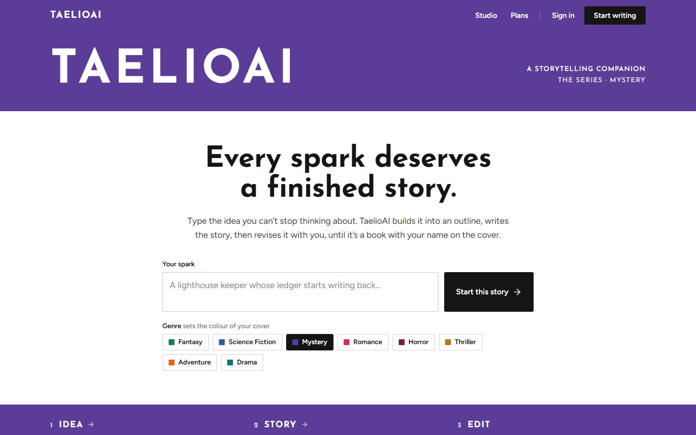
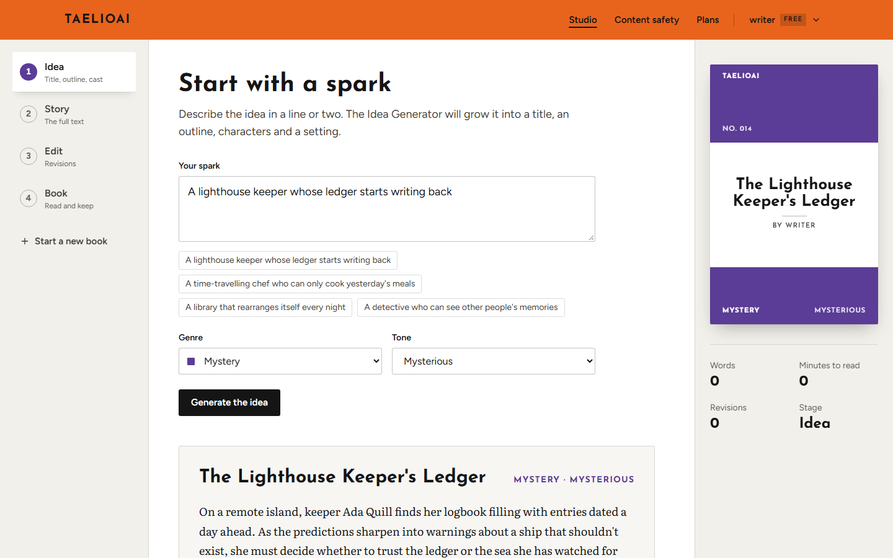
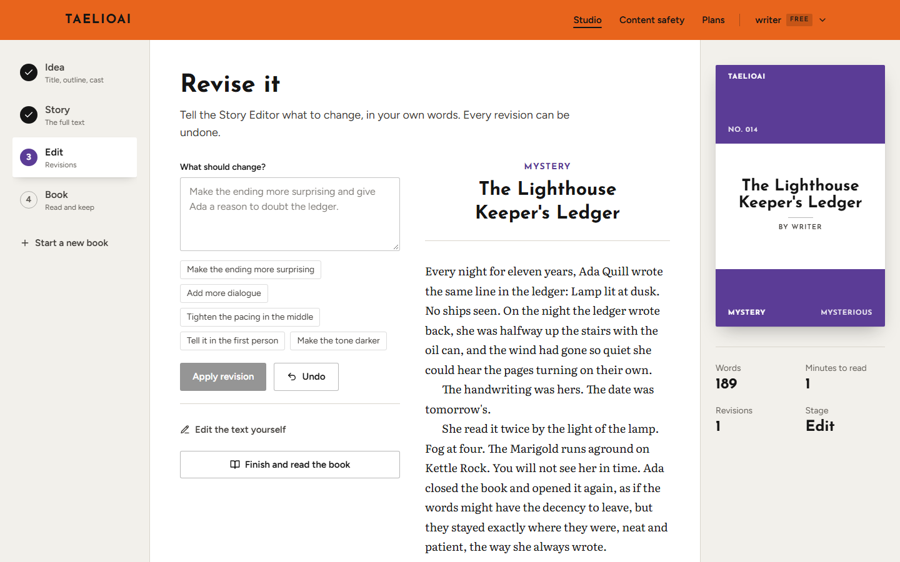
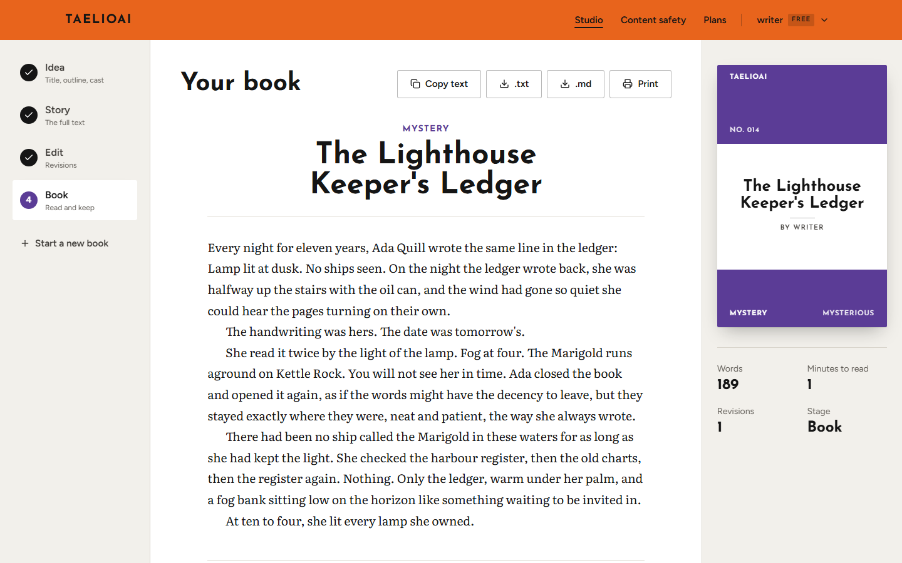
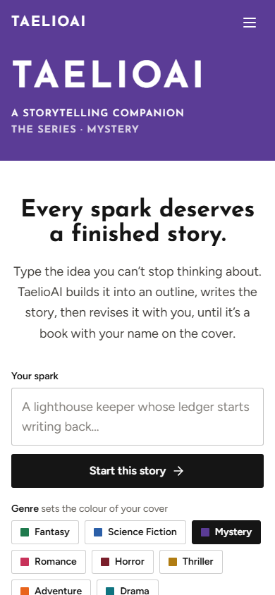
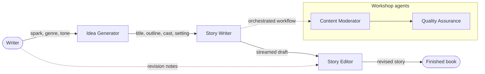
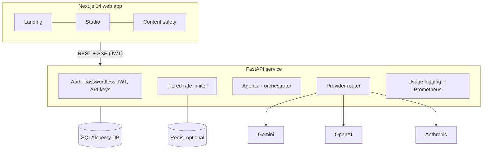

<div align="center">

# TaelioAI

**Turn a one-line spark into a finished short story.**

TaelioAI is an AI storytelling studio for hobbyist writers. A pipeline of specialised agents grows your idea into an outline, writes the story, and revises it with you until it's a book with your name on the cover.

[](https://github.com/Anjana-Janekshaka/TaelioAI/actions/workflows/ci.yml)


[Product tour](#product-tour) · [How it works](#how-it-works) · [Quick start](#quick-start) · [Architecture](docs/architecture.md) · [API](docs/api.md) · [Roadmap](#roadmap)



</div>

---

## Why TaelioAI

Most people with a story idea never finish it. A general chatbot will happily produce a story, but it hands you one block of text and loses the thread of what you wanted.

TaelioAI works the way a book gets made, one stage at a time:

| Stage | Agent | What you get |
| --- | --- | --- |
| **1. Idea** | Idea Generator | A title, outline, cast of characters and setting, grown from your spark, genre and tone |
| **2. Story** | Story Writer | The complete story, streamed onto the page as it's written |
| **3. Edit** | Story Editor | Revisions from plain-language notes ("make the ending darker"), with undo |
| **4. Book** | — | A finished, readable story you can copy, download or print |

Each stage hands its result to the next, so nothing gets retyped and the writer stays in charge of every choice.

## Product tour

<table>
  <tr>
    <td width="50%"></td>
    <td width="50%"></td>
  </tr>
  <tr>
    <td><b>Start with a spark.</b> Pick a genre and tone; the Idea Generator returns a title, outline, characters and setting. The live cover on the right fills in as your book takes shape.</td>
    <td><b>Revise in your own words.</b> Ask for changes, or pick a suggestion. Every revision can be undone, and you can edit the text by hand.</td>
  </tr>
  <tr>
    <td width="50%"></td>
    <td width="50%" align="center"></td>
  </tr>
  <tr>
    <td><b>Keep the book.</b> The finished story is set for reading, with copy, <code>.txt</code>, <code>.md</code> and print.</td>
    <td><b>Responsive.</b> The whole product works at phone width.</td>
  </tr>
</table>

Every story belongs to the **TaelioAI series**: each of the eight genres (Fantasy, Science Fiction, Mystery, Romance, Horror, Thriller, Adventure, Drama) has its own cover colour, and every book gets a series number.

## How it works





More detail in [docs/architecture.md](docs/architecture.md).

## Platform foundations

TaelioAI is built with the pieces a hosted product needs from day one:

- **Passwordless accounts.** Email sign-in issues short-lived access tokens (15 min) and refresh tokens (30 days); the web app renews sessions silently. Programmatic access via per-user API keys.
- **Plans and rate limits.** Token-bucket limits per user, per route and per tier (Free ≈ 2 requests/min, Pro ≈ 10/min), backed by Redis with an in-memory fallback.
- **Multi-provider AI routing.** Each task and tier has a primary model and an ordered fallback chain across Gemini, OpenAI and Anthropic, so one provider outage doesn't stop writing.
- **Streaming.** Stories stream to the browser over server-sent events, with a selectable writing speed.
- **Observability.** Request usage logging middleware, a Prometheus `/metrics` endpoint, a `/health` check, and admin endpoints for usage, cost and per-user leaderboards.
- **Content safety.** A Content Moderator agent scores content 0–100 and records violations; writers can review their own safety metrics.
- **Schema migrations.** Alembic-managed database schema, SQLite locally, any SQLAlchemy URL in production.

## Tech stack

| Layer | Technology |
| --- | --- |
| Web app | Next.js 14 (App Router), React 18, TypeScript, Tailwind CSS, Axios |
| API | FastAPI, Pydantic 2, Uvicorn |
| AI providers | Google Gemini (primary), OpenAI, Anthropic |
| Data | SQLAlchemy 2, Alembic, SQLite (default), Redis (rate limiting) |
| Auth | PyJWT, passwordless email, API keys |
| Ops | Prometheus client, usage logging, GitHub Actions CI |

## Quick start

**Prerequisites:** Python 3.11 or 3.12, Node.js 18+, and a [Gemini API key](https://aistudio.google.com/app/apikey). Redis is optional.

### 1. API

```bash
cd backend
python -m venv .venv
# macOS/Linux: source .venv/bin/activate    Windows: .venv\Scripts\activate
pip install -r requirements.txt

cp .env.example .env          # then set GEMINI_API_KEY and JWT_SECRET
alembic upgrade head          # creates the local database
uvicorn app.main:app --reload --port 8000
```

API docs are served at <http://localhost:8000/docs>.

### 2. Web app

```bash
cd frontend
npm install
cp .env.example .env.local    # points the app at http://localhost:8000
npm run dev
```

Open <http://localhost:3000>, sign in with any email, and start a story. On Windows, `start-backend.bat` and `start-frontend.bat` in the repo root do the same.

## Configuration

API settings live in `backend/.env` (see [`backend/.env.example`](backend/.env.example)).

| Variable | Required | Default | Purpose |
| --- | --- | --- | --- |
| `GEMINI_API_KEY` | Yes | — | Primary provider for ideas and stories |
| `OPENAI_API_KEY` | No | — | Fallback provider |
| `ANTHROPIC_API_KEY` | No | — | Fallback provider |
| `JWT_SECRET` | Yes in production | insecure placeholder | Signs access and refresh tokens |
| `JWT_ISSUER` / `JWT_AUDIENCE` | No | `taelio` / `taelio-api` | Token claims |
| `DATABASE_URL` | No | `sqlite:///./taelio.db` | SQLAlchemy connection URL |
| `REDIS_URL` | No | `redis://localhost:6379` | Rate-limit store; falls back to memory |

The web app reads one variable, `NEXT_PUBLIC_API_URL`, from `frontend/.env.local`.

## Project structure

```text
TaelioAI/
├── backend/
│   ├── app/main.py            # FastAPI app, CORS, routers, health and metrics
│   ├── api/routes/            # idea, story (+ SSE), story-editor, workflow, multi-agent,
│   │                          # moderation metrics, user, admin, provider management
│   ├── auth/                  # passwordless login, JWT, API keys, dependencies
│   ├── services/
│   │   ├── agents/            # idea, writing, editor, moderation, QA agents
│   │   ├── orchestrator/      # multi-agent workflow engine
│   │   ├── providers/         # Gemini / OpenAI / Anthropic + tier-aware router
│   │   └── limits/            # token-bucket rate limiter
│   ├── db/  alembic/          # models and migrations
│   └── metrics/               # usage logging, Prometheus
├── frontend/
│   └── src/
│       ├── app/               # landing, studio, login, register, plans, metrics
│       ├── components/        # book cover, site chrome, studio pieces
│       ├── hooks/  lib/       # API client (auth refresh, SSE), series/genre system
│       └── contexts/          # auth state
└── docs/                      # architecture, API reference, screenshots, notes
```

## Roadmap

Planned, not yet built:

- [ ] **Pro plan and billing.** The tier and its limits exist in the API; sign-up and payments do not.
- [ ] **Saved libraries.** Books currently live in the browser session; persist them per account.
- [ ] **Safety checks in the studio flow.** Run the Content Moderator and QA agents on every studio draft (today they run in the orchestrated workflow).
- [ ] **Production deployment.** Postgres, managed Redis, and a hosted demo.
- [ ] **Automated tests in CI** for the API and the studio flow.

## Contributing

This is a private product under active development. If you have been invited to contribute, read [CONTRIBUTING.md](CONTRIBUTING.md) first.

## Security

Please don't open public issues for vulnerabilities. See [SECURITY.md](SECURITY.md).

## License

Proprietary. Copyright © 2025–2026 the TaelioAI authors. All rights reserved. The source is published for viewing and evaluation only; see [LICENSE](LICENSE).
