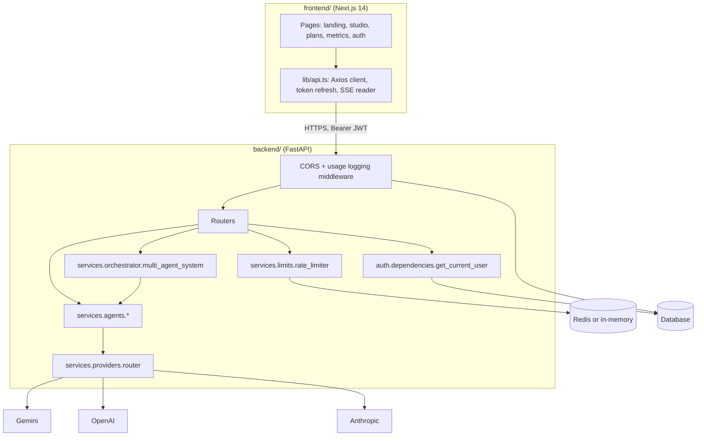

# Architecture

TaelioAI is two deployable services: a Next.js web app and a FastAPI API. The API owns accounts, limits, AI provider access and the agents; the web app is a client of the public API.

## Request lifecycle

1. The web app sends the access token in `Authorization`. When the API answers 401, the client exchanges the refresh token once and retries; if that fails it clears the session and sends the user to sign in.
2. `get_current_user` resolves the caller from the JWT (or an `X-API-Key`) and attaches the tier to the request.
3. `rate_limiter.allow(user, tier, route)` spends one token from the user's bucket for that route. Buckets live in Redis and fall back to process memory when Redis is unreachable.
4. The route calls an agent or service, which asks the provider router for a provider.
5. `UsageLoggingMiddleware` records the request; Prometheus counters are exposed at `/metrics`.

## Provider routing

`services/providers/config.py` maps each **task** (idea, story) and **tier** (free, pro, admin) to a primary provider, a model per provider, and a fallback order. The router picks the first provider in that order whose API key is configured. Gemini (`gemini-2.5-flash`) is the default primary for Free and Pro.

## Agents

All agents extend `BaseAgent` (`services/agents/base_agent.py`) with a common `process(input, context)` contract, input validation, capabilities and usage statistics.

| Agent | Module | Role |
| --- | --- | --- |
| Idea Generator | `idea_generation_agent.py` | Spark → title, outline, characters, setting |
| Story Writer | `story_writing_agent.py` | Idea → complete story |
| Story Editor | `story_editor_agent.py` | Story + instructions → revised story |
| Content Moderator | `content_moderation_agent.py` | Keyword and pattern checks, 0–100 safety score |
| Quality Assurance | `quality_assurance_agent.py` | Structural and quality review |

The orchestrator (`services/orchestrator/multi_agent_system.py`) chains agents into workflows (full story, idea only, story only), passes shared context between steps, and records per-step timing and agent metadata. The studio currently calls the idea, story and editor endpoints directly; the orchestrated endpoints also run moderation and QA.

## Data

SQLAlchemy models in `backend/db/models.py`: `users`, `plans` (tier and limits per user), `api_keys`, `usage` (per-request records, including moderation results) and `daily_aggregates`. The schema is managed with Alembic (`backend/alembic/`); run `alembic upgrade head` to create or update a database.

## Web app

- **Design system.** Every story is a paperback in the TaelioAI series: three-band covers whose colour comes from the genre (`src/lib/series.ts`), Josefin Sans for display, Figtree for UI, Literata for story text. Tokens are in `tailwind.config.js` and `src/app/globals.css`.
- **Studio state.** The book in progress (idea, fields, story, revision history) is kept in `sessionStorage`, so a refresh doesn't lose work. Server-side persistence is on the roadmap.
- **Errors.** API failures are mapped to plain-language messages (rate limit, provider not configured, server unreachable, session ended) in `friendlyError`.

## Further notes

- [Multi-agent implementation notes](notes/multi-agent-implementation.md)
- [Agent metrics fix](notes/agent-metrics-fix.md)
